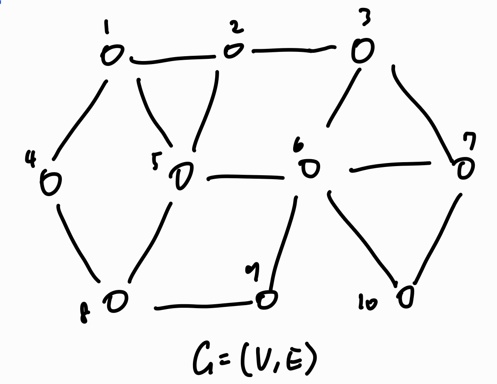
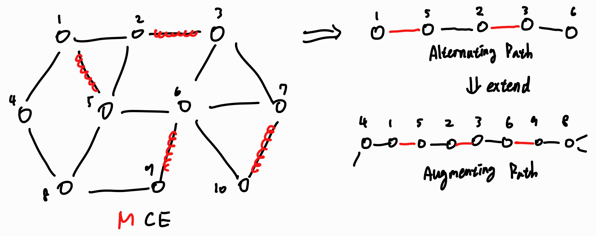
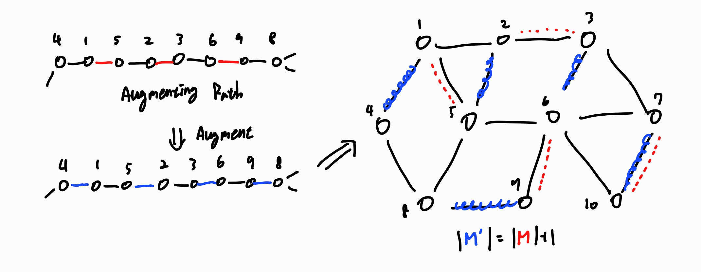
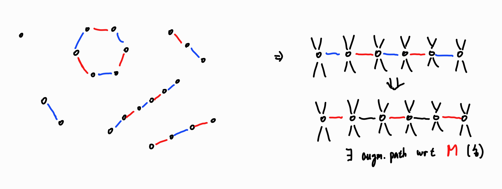
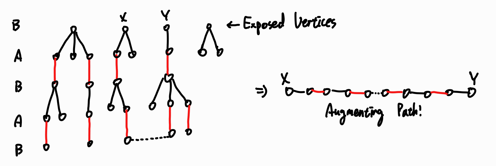
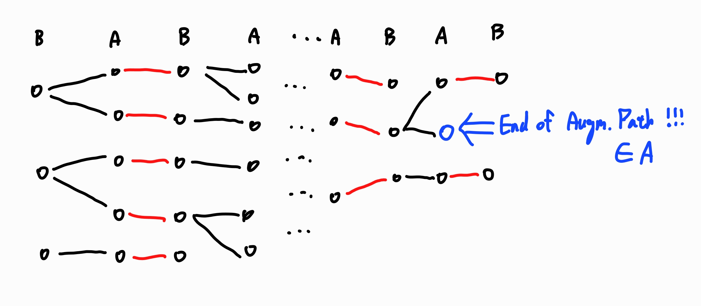
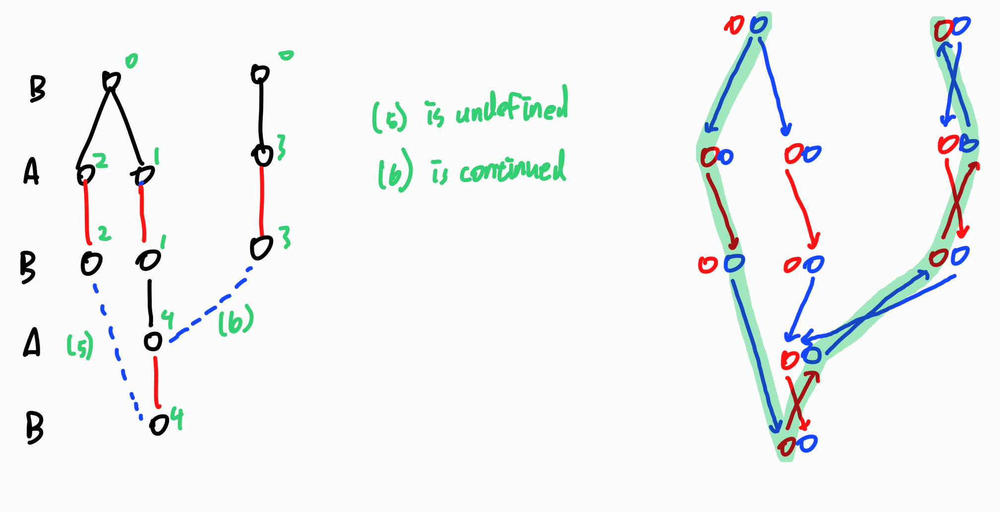
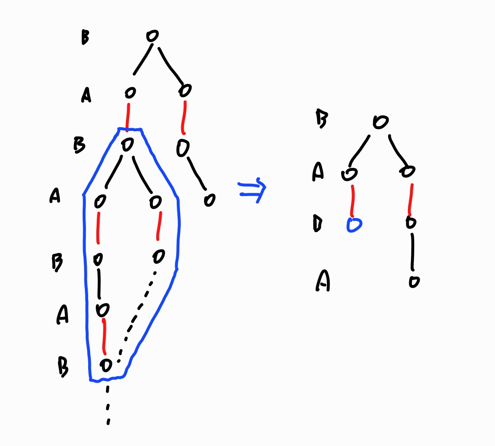
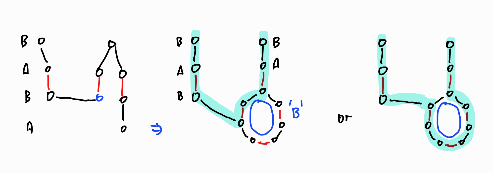

올해 5월에 동아리 모르고리즘에서 매칭 알고리즘을 다루는 세션을 했었습니다. 생각이 나서 당시 만들었던 자료를 GPT를 써서 블로그로 옮기기로 했습니다. 블라썸 글은 사실 2024년 9월에 올라갔어야 하므로 2년이나 늦었네요.

## 서론
거의 대부분의 내용은 당시 만들었던 PDF 강의자료와 동일합니다. 본 글을 '강의'라고 주장하는 부분이 몇몇 있었던 것 같은데, 글을 통쨰로 읽으면서 갈아엎을 만큼 노력을 들이고 싶지는 않아서 그냥 적당히 읽어주시면 되겠습니다.

### 사족
오늘 세션은 역대급 뉴비배척세션이 될 것 같습니다. 어려운 강의입니다. 저는 블라썸을 처음 공부할 때 ENS Paris의 Chien-Chung Huang 교수님(강의자료는 따로 없습니다)의 강의로 공부했지만 이해하지 못했고, 6개월 뒤 KAIST 이다빈 교수님의 강의 ([이쪽은 강의자료가 남아있습니다](https://dabeenl.github.io/Comb_Opt))로 다시 공부했지만 역시 전부 이해하지는 못했고, 본 세션을 준비하면서야 어느 정도 이해했습니다. 여러분도 한번에 이해하기는 어려울 것이라 생각합니다. 일단 그런 게 있구나 하고 들으신 뒤, 재밌어 보이면 그때 가서 코드포스 블로그 같은 자료를 찾아보시는 것을 추천합니다. (이다빈 교수님의 강의자료는 개인적으로 나쁘지 않았습니다.)

열심히 듣지 않은 것을 추천한다고는 써뒀지만 그럼에도 질문은 받을 예정입니다. 강의를 잘 하는 편이 아니기에 질문할 시간을 드리는 것을 잘 못 하는 편이라, 그냥 강의 중 언제든 제 말을 끊고 질문해주시면 감사하겠습니다. 물론 제 능지가 그리 좋은 편이 아니기에 모든 질문에 답변할 수 있음을 보장하지는 않습니다.

PS적으로 강의가 크게 도움이 되지 않을 겁니다. 어려운 그래프 문제에 대한 몇 가지 인사이트를 조금 얻어가실 수는 있겠다만 아마 그게 답니다. 마찬가지로 수학적으로도 도움이 될 지 잘 모르겠습니다. 그러나 재미있다고 생각하니까 일단은 한번 들어보시라, 고 얘기는 해놓겠습니다. (보통 재밌는 건 쓸 데가 없죠? 그게PS아니냐는나쁜말은노노)

그래프 이론 강의이기 때문에, 그림을 직접 그려보면서 따라오는 것이 좋습니다. 이면지나 패드/탭이나 그림판 같은 것을 준비해두시는 것을 추천합니다. 판서의 사진을 찍으셔도 되지만 어짜피 강의를 녹화해서 업로드할 예정임을 알려 드립니다.

섹션별로 어떤 사전지식이 필요한지를 섹션 시작 부분에 적어 놓았습니다. 구두로 설명하지는 않겠지만 본 문서에는 조금의 설명이 추가되어 있으니 참고하셔도 되겠습니다.

저는 블라썸을 수학 하는 교수님께 영어로 배웠습니다. 물론 저는 PS를 하는 한국 사람이지만, 용어는 최대한 영어로 통일할 예정이고 중간중간에 개념의 정의를 영어로 드릴 수 있으며 수학 하는 사람들의 용어와 공학 하는 사람들의 용어를 섞어서 쓸 예정입니다.

수학을 하시는 분들을 위한 강의가 아니므로 정의나 증명을 완전히 엄밀하게 하고 가지는 않을 겁니다. 그렇다고 구현하는 법을 열심히 설명해드리지도 않을 건데, 어차피 블라썸을 써야 할 정도의 문제는 ICPC급의 대회에서나 나오고 그런 대회에는 팀노트를 들고 갈 수 있으므로 그냥 대충대충 알아들으시면 될 것 같습니다.

그럼 시작해봅시다.

## Graph Matching and Augmenting Paths
**오늘 우리의 목표는 [BOJ 15737 - 일반 그래프 매칭](https://www.acmicpc.net/problem/15737) 문제입니다.** 정확히는, 그래프가 주어지면 다항 시간으로 그래프에서 매칭을 구하는 문제를 해결하고자 합니다. (강의를 준비할 때만 해도 BOJ가 서비스를 했었는데, 강의할 때가 다 되니까 백준이 없어졌습니다. 그런데 블로그를 올릴 때가 되니 다시 운영하게 됐으니 다행입니다.)

이 문제는, 일단 당연히 풀기 어렵습니다. 난이도가 Diamond II인 걸 보면 평생 고민해서 못 풀 수도 있을 것 같습니다. 당장 나이브하게 생각하면 $2^EV$보다 빠른 방법이 잘 떠오르지 않습니다. 여기까지는 괜찮은데, 매칭 문제는 해결한다고 해도 과연 우리가 최대 매칭을 잘 구했는지 판단하기도 어렵습니다. 최대 매칭을 보인다고 해도 ‘그것보다 더 큰 매칭이 있으면 어쩔 건데?’라는 질문을 잘 쳐낼 수 있어야 하는데, 그것도 $2^EV$보다 빨리 판단할 방법이 잘 생각나지 않습니다.

### Prerequisites
- [Graph Theory](https://en.wikipedia.org/wiki/Graph_theory): node(vertex/vertices), edge, path, cycle, BFS, DFS, degree, connected components
- [Trees](https://en.wikipedia.org/wiki/Tree_(graph_theory)): Rooted trees, parent, ancestors, children, descendant
- Forests
- [Graph Matching](https://en.wikipedia.org/wiki/Matching_(graph_theory))
- Symmetric difference (aka XOR)

**본 세션에서 그래프는 따로 명시하지 않는 경우 simple undirected graph입니다.**

그래프에서 정점이 사람을, 간선이 친구 관계를 나타낸다고 생각합시다. 이때 몇 명의 사람들을 친구인 사람들끼리 둘씩 짝지어주는 것을 생각할 수 있습니다. 이것을 matching(매칭)이라고 합니다. 형식적으로 정의하자면 $G=(V,E)$에서 $M\subset E$가 $(a,b), (a,c) \in M$ for some $a, b, c\in V$인 경우가 없다면 $M$을 매칭이라고 합니다.

당연히 짝을 지어줄 때는 짝이 없는 사람이 되도록 적게 하는 것이 좋겠죠? 그래프가 주어지면 $\|M\|$이 최대가 되는 매칭 $M$을 구하는 문제를 Maximum Matching Problem, 혹은 그냥 Matching Problem이라고 합니다. 오늘 저희가 해결할 문제는 바로 이 문제입니다.

**여기서부터는 그래프 $G=(V,E)$가 주어져 있다고 생각합시다.** 정의상 정점 개수를 $\|V\|$, 간선 개수를 $\|E\|$로 써야 하지만, 대충 $V$와 $E$로 쓸 테니 대충 알아먹으시면 되겠습니다.

*Fig. 1. 적당한 그래프를 하나 그려봤습니다. 당분간 이 그래프를 예시로 씁시다.*

### Augmenting Path
다음의 정의는 그렇게 엄밀한 정의는 아니지만 이해하는 데 문제는 없을 것입니다.
- $G$에서 매칭 $M \subset E$가 주어졌다고 합시다. 어떤 path나 cycle $P$가, 그 간선이 $M$의 간선과 $E \setminus M$의 간선이 번갈아서 나오는 형태라면, $P$를 **alternating path/cycle** 이라고 부릅니다.
- 어떤 alternating path $P$의 양 끝점이 둘 다 $M$에서 매칭되어 있지 않다면 그런 $P$를 ($M$-) **augmenting path** 라고 부릅니다. augmenting path의 양끝 정점을 **exposed vertex**라고 부릅니다.

왜 정의했는지는 잘 모르겠지만 정의 자체는 직관적이지요?

*Fig. 2. $M$이 주어지면 오른쪽처럼 alternating path 혹은 augmenting path를 잡을 수 있습니다.*

오른쪽 위와 같이 alternating path가 주어지면, 그 양끝을 조금씩 늘리는 생각을 할 수 있습니다. 정점은 한정되어 있으니 더 이상 못 늘리는 상황이 올 텐데, 그런 경우는
- 마지막으로 $M$ 간선을 지났는데 다른 간선이 하나도 없거나
- 마지막으로 Non-$M$ 간선을 지났는데 거기 있는 다른 간선도 전부 Non-$M$인 경우입니다.

전자는 저희에게 도움이 되지 않지만 후자는 꽤나 쓸모있습니다. 후자의 경우를 augmenting path라고 부른다고 생각하면 됩니다. 그려면 augmenting path 위에 있는 점들은 exposed vertices를 제외하면 모두 매칭에 포함되어 있는 점입니다. $M$ 간선이 $E\setminus M$ 간선보다 하나 적으니 간선의 개수는 홀수 개네요.

augmenting path가 왜 우리에게 쓸모있는지 봅시다.

*Fig. 3. augment 연산을 거치면 매칭의 크기가 1 늘어납니다.*

augmenting path 위에 있던 간선들에 한해서, 원래 $M$-edge였던 것들을 non-$M$-edge로, non-$M$-edge였던 것들을 $M$-edge로 만들어봅시다. $\|M\|$이 정확히 $1$ 늘어났습니다! 즉, augmenting path를 찾을 수 있으면 매칭의 크기를 늘릴 수 있게 됩니다. 조금 더 엄밀히 쓰면 $\exists$ an augmenting path on $M$ 이면 $\|M\|$을 늘릴 수 있으므로 $M$ is not a maximum matching 이 성립합니다. 그 대우인 $M$ is a maximum matching → there are no augmenting path on $M$ 도 성립하겠지요.

...그 역도 성립할까요?

만약 그 역이 성립한다면, 즉 ‘augmenting path가 없으면 최대 매칭’이라고 할 수 있다면, 그냥 아무 매칭이나 잡고 augmenting path를 찾아서 augment하는 것만 계속 반복하다 보면 최대 매칭을 얻을 수 있게 됩니다. 어차피 매칭의 크기는 $V/2$ 정도밖에 안 되니까, path 하나를 다항 시간에 구해줄 수만 있으면 최대 매칭을 적당히 빠르게 구할 수 있을 것 같습니다.

### Petersen 1891 ([Berge's Theorem](https://en.wikipedia.org/wiki/Berge%27s_theorem))
1957년에 Claude Berge가 증명하여 Berge's Theorem이라는 이름이 붙었습니다. 그러나 사실 1891년에 Julius Petersen이, 그리고 1931년에 Dénes Kőnig이 보인 바 있습니다. 따라서 저는 Petersen 1891이라고 부르겠습니다.

**Theorem 1 (Petersen 1891).** **$M$ is a maximum matching IFF there are no augmenting path on $M$**

‘augmenting path가 없으면 최대 매칭’ 부분만 증명해봅시다. 귀류법을 써서, 더 이상 augmenting path를 잡을 수 없는 매칭 $M$에 대해, $\exists M_\text{opt}$ s.t. $\|M\|<\|M_\text{opt}\|$이라 하고 $M\mathbin{\mathrm{xor}}M_\text{opt}$ 를 생각합시다. 간선의 대칭차집합을 취한다고 생각하면 됩니다.

원래 $M$에 있던 간선은 빨간색, $M_\text{opt}$에 있던 간선은 파란색으로 그립시다. 그러면 모든 정점에 대해 빨간 간선이나 파란 간선이 두 개 이상 붙어있을 수는 없지요(우린 그런 것은 매칭이라 부르지 않기로 했으니까요)?

그렇다면 $(V, M\mathbin{\mathrm{xor}}M_\text{opt})$는 모든 정점의 degree가 $2$ 이하인 그래프입니다. 이러한 그래프는 disjoint한 path와 cycle으로만 이루어져 있음을 어렵지 않게 확인할 수 있습니다. 특히, 같은 색의 간선의 연속해서 나올 수 없으므로, 이 그래프는 alternating path/cycle으로만 이루어져 있으며, 특히 그중 alternating cycle의 크기는 전부 $4$ 이상의 짝수입니다.

여기서, $\|M\|<\|M_\text{opt}\|$이므로 파란 간선이 더 많이 있는 component가 적어도 하나는 있어야 합니다. alternating cycle은 크기가 짝수이므로 두 색깔 간선의 개수 차이가 없고, 그렇다면 파란 간선이 하나 더 많은 alternating path가 하나 있어야겠네요.

이때, 이 간선은 $M$에 대한 augmenting path입니다. $M$에는 augmenting path가 없으므로 모순입니다.

*Fig. 4. 대칭차집합은 왼쪽처럼 생겨야 합니다. 즉 오른쪽과 같은 path가 있어야 하고 이는 모순입니다.*

### Implementation
앞에서 얘기했듯이, Petersen 1891만 있으면, 임의의 그래프에서 최대 매칭을 찾는 문제는 다항 시간 내에 augmenting path를 찾는 문제로 reduction할 수 있습니다. 그러면 대충 $O(n / 2 \cdot \text{finding an augmenting path})$ 정도에 문제를 풀 수 있게 되었습니다!

그럼 대충 그래프가 주어졌을 때 augmenting path를 다항 시간 내에 찾는 문제를 해결하면 되고, 이건 대충 DFS나 BFS같은 걸로 적당히 나이브하게 잘 풀면 어쨌든 다항 시간에는 되지 않을...까요?

## Hungarian Forest
...그랬으면 블라썸이 다이아 알고리즘이 아니었겠죠?

주장하는 바를 조금 더 자세히 적으면 대충 이렇습니다: 적당한 $M$이 주어지면, 전탐색으로 exposed vertex를 다 구한 뒤, 그 정점들을 모두 루트로 두고 alternating path인 간선만 탐색하도록 해서 대충 multisource BFS를 돌립니다. 대충 포레스트 같은 것이 나오다가 언젠가 서로 다른 루트에서 출발한 트리 컴포넌트가 만나면, 둘을 이어준 것이 augmenting path일 것이고 따라서 augmenting path를 찾을 수 있을 것 같습니다.

*Fig. 5. 그림으로 그리면 이런 느낌입니다.*

이 주장에 문제가 있는지 없는지 생각해봅시다.

### Prerequisites
- [Bipartite graphs](https://en.wikipedia.org/wiki/Bipartite_graph)
- [Vertex covers](https://en.wikipedia.org/wiki/Vertex_cover)

버텍스 커버란, 엄밀성을 포기하고 간단히 설명명하면, 그래프의 모든 간선에 대해 간선의 양끝점 중 하나 이상이 커버에 속하게 되는 정점 집합을 말합니다. 모든 정점을 고르면 당연히 버텍스 커버가 되기 때문에, 그래프 이론에서는 최소 버텍스 커버를 잡는 문제를 많이 연구합니다.

매칭 문제와 커버 문제는 서로 관련이 아주 많은 문제입니다. 임의의 그래프에서 최대 매칭의 크기보다 최소 버텍스 커버의 크기가 크거나 같으며, 특히 이분 그래프에서는 최대 매칭의 크기과 최소 버텍스 커버의 크기가 정확히 같음을 증명할 수 있습니다. 이것이 쾨닉의 정리(Kőnig's Theorem)입니다. 아래에서 쾨닉의 정리를 증명합니다.

### Construction of a Hungarian Forest on a Bipartite Graph
위의 주장은, 아쉽게도 이분 그래프에서는 조금만 바꾸면 잘 작동하지만 아무 그래프에서는 엣지케이스들을 쳐내기 쉽지 않습니다. 아무 그래프에서 왜 안 되는지 보기 전에, 이분 그래프에서는 왜 되는지 한 번 봅시다.

augmenting path는 무조건 홀수 개의 간선으로 이루어져 있기 때문에, 이분 그래프 $G=(U\cup V, E)$에서 augmenting path를 생각하면 무조건 두 exposed vertex 중 하나는 $U$에 있고 다른 하나는 $V$에 있습니다. 따라서, 앞에서 주장했던 알고리즘에서 '모든 augmenting path를 $U$에서 시작해서 $V$에서 끝나는 방향으로 탐색한다'는 조건을 추가로 걸어줄 수 있습니다. 그렇게 하면 모든 path를 독립적으로 구해줄 수 있을 것 같습니다.

그걸 깔끔하게 구현하자면 다음과 같이 알고리즘을 구성할 수 있습니다.

#### Algorithm 1. Hungarian Forest
calculates the Bipartite Matching in $O(VE)$

**Initialization**
- Let $G=(U\cup V,E)$
- $M$ a matching on $G$
- $A:=\emptyset$
- $B$는 $M$에서 매칭되지 않은 모든 $u \in U$의 집합으로 둡시다

**While** $\exists(u,v)$ s.t. $u \in B$
- $v \notin M$이면 augmenting path를 찾았으므로 augment하고 continue
- $v \in A(T)$면 continue (다른 길이 있으니 버려도 됩니다)
- $v \notin A(T)$ and $(w,v) \in M$ s.t. $w\in U$이면 $A$와 $B$를 그에 맞게 업데이트

포레스트의 루트를 깊이 0이라고 생각하면, $A$의 정점은 모두 깊이가 홀수, $B$는 모두 짝수가 됩니다. 또, 한 정점 당 매칭에 속한 간선은 최대 한 개밖에 없기 때문에, 한 정점당 (위에서부터) $B$에서 $A$로 가는 간선은 여러 개일 수 있지만 $A$에서 $B$로 가는 간선은 최대 한 개입니다.

*Fig. 6. 그림으로 그리면 이런 느낌입니다. Fig. 5랑 다른 점은, $B$에서 시작한 path는 $A$에서 끝나니까 두 트리 컴포넌트가 이어지는 것을 고려하지 않아도 된다는 점이 좋습니다.*

이 알고리즘이 최대 매칭을 구한다는 사실을 확인하기 위해,
- 이 매칭과 크기가 같은 vertex cover가 존재함을 보이고,
- 임의의 그래프에서 vertex cover의 크기는 매칭의 크기 이상임을 보입시다.

**Lemma 3.2.1 (버텍스커버를 제시).** When Algorithm 1 ends, $A\cup (U\setminus B)$ is a valid vertex cover of $G$.

$A\cup (U\setminus B)$으로 커버되지 않는 간선이 없음을 보이면 됩니다. 그렇다면 한쪽 끝은 $B$에 있고 반대쪽 끝은 $V\setminus A$에 있어야 합니다. 그런 정점이 있었으면 알고리즘이 끝나기 전 augmenting path가 찾아졌거나 포레스트에 추가되었어야 합니다. 즉 모든 간선을 $A\cup (U\setminus B)$으로 커버할 수 있으므로 $A\cup (U\setminus B)$는 유효한 버텍스커버입니다.

**Lemma 3.2.2 (그 버텍스커버가 매칭과 크기가 같다).** When Algorithm 1 ends, $\|A\cup (U\setminus B)\| = \|M\|$.

이때, $\|A\|$는 지금 보고 있는 헝가리안 포레스트에서 매칭의 크기와 같습니다. $U\setminus B$에 있는 것을 보면, $U$에 있는 것 중 매칭에 안 나타나는 것들은 정의상 $B$에 들어간 채로 초기화되므로 $U\setminus B$의 정점은 모두 매칭에 포함된 정점들입니다. 그 상대가 $A$였다면 우리의 포레스트에 등장했을 테니 모든 상대는 $V\setminus A$에 있습니다. 둘을 합하면 $B$에 있는 정점들은 exposed vertex를 제외하고 전부 매칭되어 있으므로, $\|A\cup (U\setminus B)\| = \|M\|$입니다.

**Lemma 3.2.3 (Weak duality of matching and vertex covers).** Given any $G=(V,E)$, (not necessarily bipartite,) $\|M\|\leq\|C\|\quad\forall M, C$ a matching and a cover.

어떤 $M$에 대해, $C$가 $M$의 모든 간선을 cover해야 합니다. $M$의 모든 간선은 pairwise vertex-disjoint하므로, 각 $M$의 양끝 점 중 적어도 하나가 $C$에 포함되어야 합니다. 따라서 $\|M\|\leq\|C\|$입니다.

**Theorem 2.** When Algorithm 1 ends, $M$ is a maximum matching.

그러면 증명이 끝나는데, 매칭이 커버보다 작거나 같아야 하고 그 등호를 찾았으므로 당연히 우리가 찾은 매칭은 최대이고 이때의 커버는 최소입니다.

사실 이분 그래프에서는 $\max\|M\|=\min\|C\|$가 성립하며, 이를 쾨닉의 정리라고 합니다. 이는 여러 가지 방법으로 증명할 수 있는데, 위에 제시한 Algorithm 1이 곧 그러한 $M$과 $C$를 찾는 올바른 알고리즘임을 보였으니 이것도 유효한 증명이 되겠습니다. 즉, 바로 아래의 따름정리를 주장할 수 있습니다.

**Corollary 3.2.1 ([Kőnig 1931](https://en.wikipedia.org/wiki/K%C5%91nig%27s_theorem_(graph_theory))).** Given any bipartite graph $G$, $\max\|M\|=\min\|C\|$.

증명을 완료했으니 시간복잡도에 대해 논의하자면, Algorithm 1은 augmenting path를 하나 찾는 데 $O(E)$ 시간이 걸립니다. 매칭의 크기는 커봤자 $O(V)$이니, 위 알고리즘은 $O(VE)$ 정도에 동작할 것입니다. 잘 알려진 Ford-Fulkerson 1956과 같은 시복이지만, 구현하기는 조금 더 복잡해 보입니다.

다만 이 알고리즘을 실제로 구현한 다음 길이가 최소인 augmenting path들을 전부 찾아 한 번에 augment하도록 조금만 수정해주면, amortized $O(E\sqrt{V}) \leq O(V^{2.5})$에 동작함을 확인할 수 있습니다.

### Hopcroft-Karp 1973 ([Hopcroft-Karp Algorithm](https://en.wikipedia.org/wiki/Hopcroft%E2%80%93Karp_algorithm))

왜 그런지 이해해 봅시다. 알고리즘의 정의는 생략합니다. Algorithm 1이랑 비슷하기도 하고, 어짜피 증명을 하다 보면 알고리즘의 정의를 알게 될 겁니다.

저게 $O(E\sqrt{V})$임을 보이기 위해,
1. 가장 짧은 augmenting path를 취하는 것을 반복하면 augment해주는 augmenting path의 길이가 단조 증가하고,
2. 근데 그렇게 하면 augmenting path의 길이로 서로 다른 것이 해봤자 $O(\sqrt{V})$개 나오고,
3. 길이가 같은 augmenting path는 무조건 pairwise disjoint해서, $O(E)$ 시간 안에 전부 다 찾아서 한 번에 augment해줄 수 있다

는 것을 보일 겁니다. 그러면 길이를 조금씩 늘려가면서 (BFS를 해주면 저건 자동으로 되겠죠?) 한 길이당 augment 한 번을 하면 $O(E\sqrt{V})$가 되겠습니다. 2번은 1번이 된다면 어렵지 않게 보일 수 있을 거 같은데, 1이랑 3은 별로 안 간단해 보입니다.

**Lemma 3.3.1 ($\|M\|$이 작으면 min augmenting path도 짧다).** Suppose $G$ has max. matching of size $X$. For a matching $M\subset E(G)$, if $\|M\|<X$, $\exists$ an augm. path of length at most $2[\frac{\|M\|}{X-\|M\|}]+1$.

증명을 위해 Petersen 1891의 construction을 한 번 더 가져옵시다. $\|M^{\prime}\|=X$인 매칭 $M^{\prime}$을 가져와서 $M\mathbin{\mathrm{xor}}M^{\prime}$을 생각하면, $M^{\prime}$-edge가 하나 더 많은 alternating path (즉 $M$-augmenting path)가 $X-\|M\|$개는 나와야 합니다. $M$-edge는 $\|M\|$개니까, 가장 짧은 augmenting path는 길어봤자 $M$-edge $\frac{\|M\|}{X-\|M\|}$개로 이루어져 있으며, 그 길이가 최대 $2[\frac{\|M\|}{X-\|M\|}]+1$임은 자명합니다.

**Lemma 3.3.2 (augmenting path는 길어진다).** Suppose $P$ is the shortest $M$-augmenting path, then for any $M\mathbin{\mathrm{xor}}P$-augmenting path $P^{\prime}$, $\|P^{\prime}\|\geq\|P\|+2\|P\cap P^{\prime}\|$.

$M$에서 찾은 augmenting path $P$에 대해 augment 연산을 $M\mathbin{\mathrm{xor}}P$로 표현했다고 생각하면 됩니다. 그렇다면 $M\mathbin{\mathrm{xor}}P$에서 새로운 augmenting path인 $P^{\prime}$를 찾았으므로, $P^{\prime}$도 augment한 매칭 $M^{\prime}$은 $M^{\prime}=M\mathbin{\mathrm{xor}}P\mathbin{\mathrm{xor}}P^{\prime}$라고 볼 수 있습니다. 그럼 $M^{\prime}$은 $M$에 augment 연산을 두 번 가한 매칭이므로 $\|M^{\prime}\|=\|M\|+2$입니다.

이번에도 $M\mathbin{\mathrm{xor}}M^{\prime}$을 생각하면, 거기서 $M$-augmenting path를 두 개 찾을 수 있어야 합니다. $P$는 정의상 $M$-augmenting path 중 가장 짧으니까 $\|M\mathbin{\mathrm{xor}}M^{\prime}\| \geq 2\|P\|$입니다. 그런데 여기서, $M^{\prime}=M\mathbin{\mathrm{xor}}P\mathbin{\mathrm{xor}}P^{\prime}$에 의해 $M\mathbin{\mathrm{xor}}M^{\prime}=P\mathbin{\mathrm{xor}}P^{\prime}$입니다. 즉, $\|M\mathbin{\mathrm{xor}}M^{\prime}\|=\|P\mathbin{\mathrm{xor}}P^{\prime}\|=\|P\|+\|P^{\prime}\|-2\|P\cap P^{\prime}\|$이 되고, 식을 잘 정리하면 $\|P^{\prime}\|\geq\|P\|+2\|P\cap P^{\prime}\|$를 얻습니다.

그러면 ($2\|P\cap P^{\prime}\|\geq0$이긴 할 테니) $\|P^{\prime}\|\geq\|P\|$도 성립합니다. 즉, 가장 짧은 augmenting path를 잡는 것만 반복하면 그 길이는 점점 길어집니다. 앞선 1번을 증명했습니다.

이제 3번을 보입시다.

**Lemma 3.3.3 (길이가 같은 augmenting path는 disjoint하다).** Suppose, from Lemma 3.3.2, we augment the paths $P_1$, $P_2$, $\cdots$, $P_n$, in order. If $\|P_i\|=\|P_j\|$ for some $i<j$, then $P_i\cap P_j=\emptyset$.

$P_i$와 $P_j$가 정점을 공유하도록 $(i,j)$를 고를 수 있다고 가정하고 모순을 끌어냅시다. 만약 $j=i+1$인 $(i,j)$를 고를 수 있다면, Lemma 3.3.2로부터 $\|P_j\|\geq\|P_i\|+2\|P_i\cap P_j\|$이고 $2\|P_i\cap P_j\|>0$이므로 쉽게 모순을 얻습니다.

(사실은 정점을 공유하는 것보다 간선을 공유하는 것이 더 강한 조건이므로 $P_i\cap P_j\neq\emptyset$임이 자명하지는 않은데,
- $P_i$와 $P_j$ 둘 다 augmenting path이고,
- $P_i$를 augment한 직후 $P_j$를 augment할 테니 두 alternating path가 exposed vertex를 공유할 수는 없고, 그렇다면 중간에 있는 정점을 공유할 텐데,
- 그러면 그 정점에 붙어 있는 유일한 $M_{i-1}\mathbin{\mathrm{xor}}P_i$-edge도 공유해야 합니다.
따라서 간선을 공유합니다.)

그러한 $(i,j)$를 잡을 수 없다면, 적당한 $(i,j)$를 잡았을 때 $i<k<j$인 모든 $k$에 대해 $P_k$가 $P_i$와도 $P_j$와도 정점을 공유하지 않아야 합니다. 그렇다는 것은 곧 $P_j$가 $M\mathbin{\mathrm{xor}}P_i$의 augmenting path이기도 해야 한다는 뜻이고, 같은 방법으로 둘을 xor해서 모순을 끌어낼 수 있습니다.

**Lemma 3.3.4 (서로 다른 길이의 수는 $O(\sqrt{V})$다).** $\|\lbrace \|P_1\|,\|P_2\|,\cdots,\|P_n\|\rbrace \| \leq 2[\sqrt{n}]+2$ and $n\leq[V/2]$.

얘는 쉬우니까 증명은 생략합니다. 따라서,

**Theorem 3 (Hopcroft-Karp 1973).** The algorithm terminates in $O(E\sqrt{V})$ time.

### Problem with Dealing Odd Cycles
헝가리안 포레스트를 이분 그래프에서는 만들기 쉽지만 일반적인 그래프에서 구하기 어려운 이유는, 홀수 사이클의 존재로 인해 모든 간선이 $U$와 $V$ 사이를 잇는다는 전제를 쓸 수 없기 때문입니다. 그러면 일단 $B$에 모든 exposed vertex를 넣고 시작해야 합니다. 이렇게 한 채로 위의 알고리즘을 그대로 쓰면 언젠가 $B$에서 $B$로 가는 간선을 만나게 되는데, 그 순간 이 간선으로 인해 만들어지는 홀수 사이클이 문제가 됩니다. 이 사이클 위에 있는 모든 점들은 (그 정점이 속한 컴포넌트에서 생각하면) 루트로부터 홀수 길이로도 짝수 길이로도 도달할 수 있습니다. 이것을 잘 저장해두지 않으면 나중에 다른 컴포넌트에서 날라오는 간선으로부터 만들어질 수 있는 augmenting path를 놓칠 수도 있습니다.

*Fig. 7. 왼쪽의 그래프를 생각하면 B-B edge를 처리하기가 까다롭다는 것을 알 수 있습니다. 오른쪽처럼 각 정점의 odd-reachability와 even-reachability를 둘 다 관리하는 생각을 할 수 있긴 할텐데, 그러면 한 정점을 두 번 방문하는 케이스가 생길 수 있습니다. 적당히 하면 이것도 잘 무시할 수 있는 방법이 있을 수도 있겠다만, 별로 좋은 생각은 아닌 것 같습니다.*

## The Blossom Algorithm
그러니까 $B$에서 $B$로 간선이 생겼을 때 어떻게 하는지만 잘 정의한 알고리즘이 있으면 일반적인 그래프에서 매칭 문제를 풀 수 있겠죠?

### Prerequisites
- [Edge Contraction](https://en.wikipedia.org/wiki/Edge_contraction)
- [Lowest Common Ancestor](https://en.wikipedia.org/wiki/Lowest_common_ancestor)
그래프가 주어졌을 때, 간선으로 이어져 있는 두 정점을 하나로 합치는 것을 생각할 수 있습니다. 그 과정에서 두 정점 중 하나 이상과 연결되어 있는 정점은 모두 새로운 정점이랑 이어주면 됩니다. 이것을 그 간선을 contract했다고 하며, 이를 edge contraction이라 부릅니다. 일종의 정점 homomorphism이라 생각할 수도 있겠습니다.

### Edmonds 1965 ([Edmond's Blossom Algorithm](https://en.wikipedia.org/wiki/Blossom_algorithm))
루트로부터 홀수 길이로도 짝수 길이로도 도달할 수 있다는 사실을 어떻게 저장할 지 생각해봅시다. 이 사이클에서 나가는 간선은 ‘사이클의 루트의 부모’로 가는 간선이 아니면 Non-$M$ 간선입니다. 그리고, 잘 생각해보면, 다른 컴포넌트에서 이 사이클로 날아오는 Non-$M$ 간선이 있다면, 사이클을 이쪽 방향으로 돌거나 저쪽 방향으로 돌거나 하면 무조건 augmenting path를 찾을 수 있습니다.

즉, 홀수 사이클은 단일 $B$-정점과 똑같이 행동합니다. 따라서, 이 홀수 사이클을 정점 하나라고 퉁쳐봅시다.

#### Algorithm 2. Edmonds 1965
Blossom Algorithm : calculates the General Matching in $O(V^2E)$
**Initialization**
- Let $G=(V,E)$
- $M$ a matching on $G$
- $A:=\emptyset$
- $B$는 $M$에서 매칭되지 않은 모든 $u$의 집합으로 둡시다 (원래는 $U$에 있는 것만 넣었지만, 이제 그럴 수 없으니 전부 넣었습니다)

**While** $\exists(u,v)$ s.t. $u \in B$
- ($v \notin M$이면, 그런 $v$는 이미 $B$에 속합니다)
- $v \in A$면 continue (다른 길이 있으니 버려도 됩니다)
- $v \notin A$ and $(w,v) \in M$ s.t. $w\in U$이면 $A$와 $B$를 그에 맞게 업데이트 (alternating path를 연장합니다)
- $v \in B$이면...
**If** $u, v \in B$
- 만약 $u$와 $v$가 같은 포레스트에서 나왔다면? (Case 1)
    - Let $w := \text{LCA}(u,v)$
    - 홀수 사이클을 찾았습니다. 이 홀수 사이클은 LCA를 공유하고 있으므로 딱히 augmenting path가 찾아졌다거나 하지는 않습니다.
    - Contract all edges between $w-u$, $u-v$, $v-w$ (홀수 개의 간선)
    - continue (while의 다음 iteration을 시작)

  *Fig. 8. Case 1에 해당하는 그림입니다. 홀수 사이클을 파란색 정점으로 contract했습니다.*

- 아니면? (Case 2)
    - $u$와 $v$를 포함하고 있는, 포레스트의 두 연결 요소 트리 $T_1$, $T_2$와 각각의 루트 $P_1$, $P_2$에 대해, path $P_1-u-v-P_2$는 augmenting path
    - path 위에 있는, 이전에 contract했던 덩어리들을 모두 decontract해주고 augmenting path를 augment
    - continue (매칭의 크기가 늘어났으므로, while을 처음부터 다시 시작)

  *Fig. 9. Case 2에 해당하는 그림입니다. 가장 왼쪽 그림이 Fig. 7의 컴포넌트를 포함하고 있음을 눈여겨 보시면 좋습니다. 이 ‘블라썸’으로 들어가는 간선이 있다면, 블라썸을 시계방향으로 돌든 반시계방향으로 돌든 한 쪽으로는 augmenting path를 무조건 찾을 수 있음을 볼 수 있습니다.*

자, 무언가 복잡한 연산 두 개를 붙여 보았습니다. Blossom이라는 이름은 사이클을 contract하고 decontract하는 과정이 꽃이 피는 것과 비슷한 모양이라고 하여 붙은 이름입니다. 따라서, contract하는 홀수 사이클을 Blossom이라고 하고 contract/decontract 연산을 블라썸 연산이라고 부르기도 합니다.

### Observations and Proofs
Case 1에서, LCA는 무조건 짝수 깊이의 (즉 $B$에 속한) 정점입니다. 따라서 블라썸은 한 곳에만 non-$M$ 간선이 두 개 붙어있고 나머지 간선은 모두 alternating하며 non-$M$ 두 개가 붙어 있는 정점이 유일하게 가장 깊이가 낮은 정점이 된다는 성질을 가지게 됩니다.

이것 때문에 블라썸에 속한 모든 정점은 매칭에 속한 정점이고, 그래서 어짜피 다음으로 탐색할 간선이 non-$M$ 간선이 됩니다. 그래서 블라썸을 contract해도 여전히 augmenting path를 찾으면 된다는 성질이 유지됩니다. 그리고 블라썸은 alternating하니까, contract한 그래프에서 Case 2로 augmenting path를 찾았다면 decontract한 다음 블라썸의 한 쪽으로 돌면 무조건 augmenting path를 하나 잡을 수 있음을 알 수 있습니다. 이걸 정리하면

**Lemma 4.3.1.** There is an augmenting path $p$ in $G$ with respect to $M$ IFF there is an augmenting path $p^{\prime}$ in $G/B$ with response to $M/B$ where $B$ is a blossom from Case 1

와 같이 쓸 수 있습니다.

Lemma 4.3.1을 쓰면, contract 연산을 주구장창 한 상태에서도 더 이상 augmenting path를 구할 수 없다면 모든 블라썸을 decontract했을 때의 상태가 최대 매칭이라는 주장이 성립합니다. 그러니까 알고리즘이 끝나면 augmenting path가 없다는 명제를 증명해주면 됩니다.

**Lemma 4.3.2.** In the final round of Blossom, let $G^{\prime}$ and $M^{\prime}$ be the final graph and the corresponding matching. let $A, B$ be as defined by the algorithm and $U = G^{\prime} \setminus A \cup B$. Then, All blossoms contracted are part of $B$.

contract한 블라썸은 모두 단일 정점입니다. $u, v \in B$일 때 두 정점의 LCA였던 정점 자리에 블라썸이 들어가고, 이 정점은 원래 그래프에서 두 개(이상)의 자식을 가지고 있었으므로 $B$에 속한 정점입니다.

**Lemma 4.3.3.** There is no edge of $G^{\prime}$ in $B \times (B \cup U)$.

$B$에서 $B$로 가는 간선이 있다는 건 위의 case 1에 의해 블라썸을 찾았다는 말이거나 case 2에 의해 augmenting path를 찾았다는 말입니다. 알고리즘이 끝났다면 그런 일은 없습니다. $B$에서 $U$로 가는 간선이 있다면 이분 그래프에서와 같은 방법으로 정점을 추가해주어야 하므로 알고리즘이 끝났다면 그런 일 역시 없습니다.

여기까지만 해줘도 augmenting path가 없음을 보이기에 충분합니다.

**Theorem 4.** $\nexists$ $M^{\prime}$-augmenting path on $G^{\prime}$, that is, $M$ is a maximum matching.

exposed vertex가 다 $B$에 들어가 있으므로 augmenting path가 있다면 $B$에서 출발해서 끝나야 합니다. 근데 Lemma 4.3.3에 의해 $B$에서는 $A$로만 갈 수 있고, 즉 $B$에서 출발한 path는 B-A-B-A-...여야 합니다. 그러면 반대쪽 끝이 B이면서 간선을 홀수 개 쓸 수 없습니다.

아래는 그래프를 관찰하면 찾을 수 있는 몇 가지 추가적인 성질입니다:

**Lemma 4.3.4.** All vertices in $A$ are matched to some other vertices in $B$.

$A$에 정점을 넣을 때는 항상 $A$에서 $B$로 가는 다른 정점이 있는지 확인하고 있을 때만 넣었습니다. 따라서 얘도 자명하게 성립합니다.

**Lemma 4.3.5.** All vertices of $U$ are matched to one another.

매칭이 안 된 정점은 다 exposed vertex 후보이므로 $B$에 있습니다. 따라서 $U$에 있는 것들은 이미 매칭이 되어 있습니다. Lemma 4.3.4에 의해 그 상대가 $A$는 아닙니다. 그 상대가 $B$라면 $U$의 정점도 트리에 있어야 하는데 그렇지 않습니다. 따라서 $U$에 있는 매칭된 것들은 $U$끼리만 매칭되어 있습니다.

**Lemma 4.3.6.** Number of unmatched vertices is equal to $|B| - |A|$.

$|B|-|A|$의 값은 헝가리안 포레스트에서 루트의 개수와 같습니다. (나머지는 전부 A와 B가 쌍을 이루거나 U의 두 정점이 쌍을 이루고 있습니다.)

시간복잡도를 논의하자면,

- augment 연산은 최대 $O(V)$번 할 수 있습니다.
- 한 번의 augment 연산에서 블라썸은 최대 $O(V)$개 만들어야 합니다.
- 블라썸을 만들었을 때마다 $O(E)$정도 순회해야 합니다.

따라서 위와 같이 구현하면 $O(V^2E)$입니다.

### Pape-Conradt 1980
풀 수 있다는 사실 정도는 알겠습니다. 무엇을 구현해야 하는지 생각해 봅시다. 명시적으로 블라썸을 구현하는 것을 생각할 수 있지만, 구현하는 데 10시간 정도 걸릴 것 같습니다. 디버깅하는 데는 10년 정도 걸릴 것 같습니다. 따라서 Pape-Conradt 1980의 구현 방법을 알아두면 좋습니다.

블라썸을 진짜로 contract하지 말고, 그냥 각 정점이 속한 블라썸의 LCA가 몇 번 정점인지만 각 정점에 기록합시다. (블라썸에 속하지 않는 정점은 -1으로 두던가 합시다.) 각 정점은 A 혹은 B에 속하는데, 블라썸은 짝수 거리에 있는 정점 하나와 같으므로 블라썸에 속하는 정점은 모두 B에 속한다고 생각합시다.

이렇게 하면 한 번의 BFS로 augmenting path를 찾거나 알고리즘을 끝내는 것을 바로 할 수 있고, 그 과정에서 만들어지는 블라썸의 크기 합도 $O(V)$에 바운드할 수 있습니다. 따라서, 명시적으로 contract-decontract 연산을 구현하지 않아도 됨은 물론 결론적으로 하나의 augmenting path를 찾는 데 걸리는 시간을 $O(V+E)$ 수준으로 줄였습니다. 따라서 이와 같이 구현하면 General Matching을 약 $O(V(V+E))\simeq O(VE)\leq O(V^3)$에 얻을 수 있습니다.

구현 방법을 너무 자세하게 설명하지는 않았는데, Appendix에 적당한 구현체를 작성해뒀으니 참고하시어 공부하시면 되겠습니다. 약 $O(VE)$에 돌아가는 구현체를 Implementation 1에서 찾아보실 수 있습니다.

## Further Studies on General Matching
아래의 내용은 저도 잘 모릅니다. 참이 아닌 내용이 나올 수도 있고, 질문하셔도 제대로 된 답변을 얻지 못하실 수도 있습니다. 저도 이해하지 못한 것이 많기 때문에 어떤 사전지식이 필요한지는 잘 모르지만,

여기까지만 해도 PS에서 다룰 수 있는 정도의 무가중치 일반 그래프 매칭은 다 확인했다고 할 수 있겠습니다. 소개한 알고리즘들을 어떻게 구현할 수 있는지, 여기서 더 나아가면 무엇이 있는지, 지금의 SOTA가 무엇인지에 대해 잠깐 소개하겠습니다. 아래의 1., 2., 5.는 공부해볼 만한 가치가 있어 보이고, 관심이 있으시다면 나머지를 확인해보시면 재밌을 수도 있겠습니다.

1. 앞서 소개한 Implementation 1은 Pape-Conradt 1980의 구현체입니다. 각 정점이 어떤 블라썸에 속해 있는지를 저장하기 위해 Union-Find를 사용하며 $O(VE\log^{\ast}V)$에 동작합니다.
2. Dense graph라면 굳이 유파를 사용하지 않고 LCA를 $O(V)$에 찾아 $O(V^3)$으로 작성해도 되며, 이렇게 하면 코드가 조금 더 간단합니다. 물론 이쪽의 구현을 암기할 수 있으면 거기에 log 유파만 얹어도 sparse graph에서 유의미하게 빨라질 것 같긴 합니다. 실제 구현체는 Implementation 2에서 확인할 수 있습니다.
3. Implementation 3은 Codeforces에서 찾은 $O(V^3)$ 구현인데, 잘 읽어보지는 않았지만 Impl 2에 비해 조금 더러운 대신 꽤 짧은 것 같으니 팀노트를 준비하시는 분들은 이쪽을 사용하셔도 좋을 것 같네요.
4. Micali-Vazirani 1980은 Hopcroft-Karp의 아이디어를 이용해 $O(E\sqrt{V})$에 문제를 해결할 수 있음을 보였습니다. Sparse graph에서의 최대 매칭은 $O(E\sqrt{V})$가 45년째 SOTA입니다. 물론 이쪽의 구현은 Impl 1이나 2에 비해 엄청 길고, CP 환경에서는 시간이 무한정 주어진 게 아니라면 이쪽을 구현할 일은 없다고 봐도 되겠습니다. 그나마 시도해볼 만한 $O(E\sqrt{V})$ 구현체로는 Gabow 2017이 있으며, 실제로 구현한 코드는 Implementation 4에서 찾을 수 있습니다. (이쪽의 시복은 $\log V$가 하나 더 붙습니다. 이렇게 구현하는 것이 훨씬 쉽기 때문입니다.) 저는 이쪽의 원리를 아직 이해하지 못했습니다.
5. 그래프를 관리하지 않고 선형대수학적으로도 문제를 다룰 수 있습니다. Tutte Matrix $A$는 $A_{ij}$값을
     - $(i,j)\in E$이고 $i<j$이면 변수 $x_{ij}$,
     - $(i,j)\in E$이고 $i>j$이면 $-x_{ij}$,
     - $(i,j)\notin E$이면 $0$
   으로 둔 $V \times V$의skew-symmetric 행렬입니다. 이때, 이 행렬의 rank가 무조건 $G$의 최대 매칭의 크기의 두 배가 됨이 알려져 있습니다. 따라서 각 변수를 랜덤한 정수로 두고 가우스 소거법 같은 것을 써서 행렬의 rank를 구하면 이 값의 절반이 높은 확률로 최대 매칭의 크기와 같으며, 블라썸을 몰라도 이것을 기억하고 있으면 주어진 그래프의 최대 매칭의 크기 정도는 어렵지 않게 구할 수 있습니다.
6. Mucha & Sankowski 2004는 Tutte Matrix에서 매칭에 포함되는 간선을 얻어낼 수 있음을 보였고, Harvey 2009가 실제로 이를 구하는 알고리즘을 제시했습니다. 역행렬을 구하거나 행렬 곱셈을 구하는 것의 SOTA는 Alman-Duan-Williams-Xu-Xu-Zhou 2024에 의해 $O(N^{2.371})$ 정도이므로 $O(V^{2.371})$에 최대 매칭을 구할 수 있으며, Dense graph에서는 앞선 $O(E\sqrt{V})=O(V^{2.5})$보다 이쪽이 더 빠릅니다. Dense graph에서 현재 알려진 SOTA는 이쪽입니다. 다만 PS의 범위에서는 슈트라센 알고리즘 (Strassen 1969)이 훨씬 빠르고 그것보다 Gabow 2017이 더 빠르므로 PS를 할 때 이쪽을 구현할 일은 없습니다.

## 부록 A. Graphs, Trees, Forests
그래프를 형식적으로 정의하면 다음과 같습니다.
$$
G:=(V,E)
$$
여기서 $V$는 vertex 집합, $E$는 edge 집합입니다. 이때 edge는 보통 unordered pair of vertices $(a,b)$ s.t. $a\neq b; a, b \in V$로 정의합니다. **오늘은 $E$가 multiset인 경우나 $a=b$인 경우를 생각하지 않습니다.**

path는 한 정점을 여러 번 방문하지 않으면서 간선을 몇 번 따라가서 얻는 경로를 의미합니다. 시작점과 종점이 같으며 나머지 정점은 여러 번 방문하지 않는다면 이는 cycle입니다.

그래프에서 어떤 정점의 degree(차수)는 그 정점에 연결된 간선의 개수입니다.

그래프 위의 어떤 점에서 다른 모든 점으로 가지 못할 수도 있습니다. 그렇다면 그래프는 간선으로 연결되어 있는 묶음들으로 나눌 수 있을텐데, 각 묶음을 connected component, 혹은 줄여서 component라고 합니다. 만약 그래프가 하나의 컴포넌트를 이룬다면 그러한 그래프를 connected graph(연결 그래프)라고 합니다.

어떤 그래프가 사이클을 하나도 가지지 않는다면, 그러한 그래프를 forest(포레스트)라고 하고, 연결 그래프인 포레스트를 tree(트리)라고 합니다. 즉, 포레스트는 하나 이상의 트리인 컴포넌트로 이루어져 있습니다.

트리를 한 점을 중심으로 하여 나머지 점들이 아래쪽으로 뻗어나가도록 그리면 가계도 같은 그림이 됩니다. 이때 중심으로 두었던 정점을 root라고 하고, 각 정점에 대해 그 정점의 바로 위에 있는 정점을 parent라고 합니다. 그러면 그 역으로 child를 정의할 수 있고, 그럼 ancestor와 descendant도 적당히 정의할 수 있겠습니다.

트리에서 두 정점의 Lowest Common Ancestor는 두 정점 모두의 조상인 정점 중 가장 루트로부터 멀리 떨어진 정점입니다.

이분 그래프는 일반적으로 다음과 같이 정의하며,
$$
G:=(U\cup V,E)
$$
이때 모든 간선은 $u \in U$와 $v \in V$를 이어야 합니다. 즉, $U$와 $V$는 각각 그 안에 간선이 없어야 합니다. 사실 정점 집합이 어떻게 주어지든간에 위의 정의에 맞게 정점을 $U$와 $V$로 나눌 수 있으면 이분 그래프라고 부릅니다.

이때 주어진 그래프가 이분 그래프인 것과 이 그래프가 홀수 사이클을 가지지 않음이 필요충분입니다.

## 부록 B. Implementations
~~강의자료가 올라간 구글 드라이브 공유 폴더에서 `blossom_impl.zip`을 다운받아서 확인하시면 됩니다.~~ 
- implementation 1: impl 2를 제가 수정한 코드입니다.
- implementation 2: HYEA님이 작성하신 솔루션입니다. 소스코드는 <https://github.com/koosaga/olympiad/blob/master/Library/codes/combinatorial_optimization/matching_short.cpp> 에서 가져왔습니다. 이에 대한 설명은 <https://blog.kyouko.moe/20?category=767011> 과 <https://t1.daumcdn.net/cfile/tistory/9916F74B5B4762BD26> 에서 확인하실 수 있습니다.
- implementation 3: Adamant님이 작성하신 솔루션입니다. 소스코드는 <https://codeforces.com/blog/entry/92339>에서 가져왔으며 이에 대한 설명도 같은 링크에서 확인하실 수 있습니다.
- implementation 4: min\_25님이 작성하신 솔루션입니다. 소스코드는 <https://github.com/koosaga/olympiad/blob/master/Library/codes/combinatorial_optimization/matching.cpp> 에서 확인하실 수 있습니다.

## 부록 C. Further Readings and Reference Materials
- 서론에서 언급한 것과 같이, 이 강의는 [IBS DIMAG](https://dimag.ibs.re.kr/)의 [2024 SSCA](https://combialgo.dimag.kr/2024/)에서 진행된 [Chien-Chung Huang (ENS Paris, France)](https://www.di.ens.fr/~cchuang/) 교수님의 강의 Combinatorial Optimization과 [POSTECH CALOP](https://calop.postech.ac.kr/calop-postech/index.do)의 2024/25 Winter Lecture에서 진행된 [이다빈 (SNU)](https://dabeenl.github.io/) 교수님의 강의 [Introduction to Modern Combinatorial Optimization](https://dabeenl.github.io/Comb_Opt)을 기반으로 합니다. 이전에 [mingyu331](https://solved.ac/profile/mingyu331)이 제공해줬던 Combinatorial Optimization 강의의 필기도 많은 도움이 되었습니다. 이다빈 교수님의 강의는 [유튜브](https://youtube.com/playlist?list=PLoAy6KucOX-uL_qdG8l7Ii-hXGC7SX0n2&si=d1TAA116fWGPMN8n)에서도 확인하실 수 있습니다.
- 본 강의에서 언급하는 논문 중 일부는 다음에서 확인하실 수 있습니다: [Hopcroft-Karp 1973](https://epubs.siam.org/doi/10.1137/0202019), [Gabow 2017](https://arxiv.org/pdf/1703.03998), [Edmonds 1965](https://www.cambridge.org/core/journals/canadian-journal-of-mathematics/article/paths-trees-and-flowers/08B492B72322C4130AE800C0610E0E21), [Berge 1957](https://www.pnas.org/doi/abs/10.1073/pnas.43.9.842), [Micali-Vazirani 1980](https://ics.uci.edu/~vazirani/MV.pdf), [Kim 2024](https://qoj.ac/problem/8726),  [Mucha-Sankowski 2004](https://web.eecs.umich.edu/~pettie/matching/Mucha-Sankowski-planar-matching-journal-version.pdf).
- Pape-Conradt 1980을 이해하는 데는 [HYEA님의 포스트](https://blog.kyouko.moe/20?category=767011)의 도움을 받았습니다. Edmonds 1965를 어느 정도 이해하셨다면 Pape-Conradt 1980과 그 구현의 이해를 위해 이쪽이 큰 도움이 될 것입니다.
- 많은 정보(특히 Further studies의 내용)를 [koosaga님의 포스트](https://koosaga.com/258)를 통해 공부했습니다. 이쪽은 블라썸 알고리즘을 가지고 할 수 있는 다양한 주제들을 메인으로 다루고 있으니, 블라썸 알고리즘이 어느 정도 이해되신 것 같다면 공부해보도록 합시다.
- Hopcroft-Karp에 대한 내용은 거의 전부 [Gazelle님의 포스트](https://gazelle-and-cs.tistory.com/35)로 공부했습니다. 저보다 잘 설명해두셨으니 이해가 되지 않는 내용이 있으면 이쪽을 참고하셔도 좋을 것 같습니다.

감사합니다.
